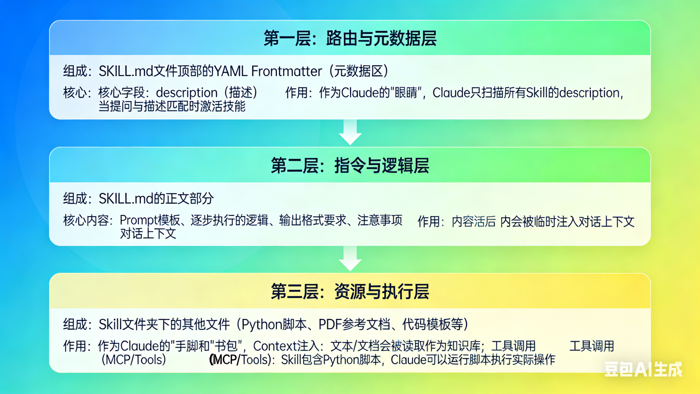

---

title: 解构 Anthropic Agent 标准：深入理解并构建 Claude Skills
date: 2026-02-03 15:30:00+08:00
draft: false
categories: ["技术"]
tags:
- Anthropic Agent
- Claude Skills
- 大模型编程
- claude code
- AI
- agent skill
permalink: agent-memory/个人随笔站点/资料库/site-src/content/posts/agent-skill/index-1
---

# 解构 Anthropic Agent 标准：深入理解并构建 Claude Skills

**简介：**

在大模型应用开发中，如何让 LLM 既保持通用的对话能力，又能精准执行特定领域的复杂任务？Anthropic 最近推出的 **Claude Code** 和配套的 **Skills 架构** 给出了一个优雅的答案。

这里的 Skills 并非简单的系统提示词（System Prompt），而是一个包含**路由层（Router）、指令层（Instruction）和执行层（Execution）**的完整微服务架构。它允许 Claude 根据用户意图动态挂载上下文，甚至调用本地 Python 脚本执行实际操作。这实际上是将传统的“人机对话”升级为了“人与 Agent 的协作”。

在这篇文章中，我整理了基于官方文档Skills 的运行原理，并跳过繁琐的理论，通过贴近实际的演示案例来如何利用 Claude 的自举能力（Bootstrapping）来快速构建高效的 Agent 技能包。

## 一、安装要求：

网络环境需要自己解决，我建议使用Linux（Ubuntu系统），如果你是Windows系统可以安装WSL配合Vscode插件也非常好用

在 **Ubuntu 系统**（需为 20.04+ 版本）上安装 Claude Code 非常简单，官方推荐使用**原生安装程序**。

以下是具体的安装步骤：

1. 系统要求检查

• **操作系统**：Ubuntu 20.04 或更高版本。

• **硬件**：至少 4 GB 内存。

• **网络**：需要互联网连接。

2. 执行安装命令（推荐方式）

在终端中直接运行以下官方提供的**原生安装脚本**，这是最快且最稳定的方式：,

```
curl -fsSL https://claude.anthropic.com/install.sh | sh
```

此脚本会自动下载适用于 Linux 的二进制文件并完成配置。

## 二、Skills 的架构与运行原理

Claude Skills（特别是用于 Claude Code CLI 的 Skills）的核心设计理念是**按需加载的专家系统**。它的架构可以清晰地分为三层：



#### 1. 架构分层

- **第一层：路由与元数据层 (Metadata / Router Layer)**
  
  - **组成**：位于 SKILL.md 文件顶部的 YAML Frontmatter（元数据区）。
  
  - **核心字段**：description（描述）。
  
  - **作用**：这是 Claude 的“眼睛”。Claude 不会一次性读取所有技能的详细内容（那样会消耗太多 Context）。相反，它只扫描所有 Skill 的 description。当你的提问（Prompt）与某个描述匹配时，它才会决定“激活”这个技能。

- **第二层：指令与逻辑层 (Instruction Layer)**
  
  - **组成**：SKILL.md 的正文部分。
  
  - **核心内容**：Prompt 模板、逐步执行的逻辑、输出格式要求、注意事项。
  
  - **作用**：这是 Claude 的“大脑”。一旦技能被激活，这部分内容就会被临时注入到当前的对话上下文中，仿佛你刚刚对 Claude 说了一段非常详细的系统提示词（System Prompt）。

- **第三层：资源与执行层 (Resource & Execution Layer)**
  
  - **组成**：Skill 文件夹下的其他文件（Python 脚本、PDF 参考文档、代码模板等）。
  
  - **作用**：这是 Claude 的“手脚”和“书包”。
    
    - **Context 注入**：如果是文本/文档，Claude 会读取它们作为知识库。
    
    - **工具调用 (MCP/Tools)**：Skill 可以包含 Python 脚本，Claude 可以通过运行这些脚本来执行实际操作（如通过 API 发推文、查询数据库、转换文件格式）。
    
    - **架构示例**
      
      你的 Skill 文件夹（例如：my-weekly-report/）
      ├── SKILL.md                  # 必须！核心文件，包含 YAML 元数据 + 详细指令
      │
      ├── scripts/                  # 可选：存放可执行脚本（Python、Bash 等）
      │   ├── generate_chart.py     # 示例：生成图表的 Python 脚本
      │   ├── validate_data.sh      # 示例：数据校验脚本
      │   └── utils/                # 可选子目录，进一步组织复杂脚本
      │       └── helper.py
      │
      ├── references/               # 可选：参考文档、知识库（Markdown、TXT 等）
      │   ├── api-spec.md           # 示例：API 规范参考
      │   ├── brand-rules.md        # 示例：品牌规范细节
      │   └── examples/             # 可选子目录，放更多示例
      │       └── sample-report.md
      │
      ├── assets/                   # 可选：静态资源（模板、图片、字体等）
      │   ├── logo.png              # 示例：公司 logo
      │   ├── report-template.pptx  # 示例：PPT 模板文件
      │   └── fonts/                # 可选子目录
      │       └── custom-font.ttf
      │
      └── README.md      # 强烈不推荐放在这里！（人类阅读用放仓库根目录即可）

#### 2. 工作机制 (工作流程)

1. **用户输入**：你在终端输入 claude "帮我把这个 PDF 转换成 PPT"。

2. **意图识别 (Router)**：Claude 扫描 .claude/skills 目录下所有技能的 description。

3. **动态加载**：它发现 pptx-gen 技能的描述是“将文档转换为 PowerPoint”，于是**激活**该技能。

4. **上下文注入**：Claude 读取该技能的 SKILL.md 正文，明确了转换的步骤（例如：先提取大纲，再生成每页内容）。

5. **执行与反馈**：Claude 根据指令调用技能文件夹下的 Python 脚本（如果有）进行转换，并最终输出结果。

#### 3.写法模板

**技能名称要和文件名一致**

```
---
name: 我的技能名称
description: 对这个技能的功能和适用场景的清晰描述
，例如“当用户要求生成周报、总结工作或输出固定格式报告时使用本技能”
---

# 我的技能名称

[在这里添加 Claude 在此技能激活时需要遵循的详细指令和规则]

## 示例
- 示例用法 1：用户输入“写一份周报”，Claude 应自动套用标准模板输出
- 示例用法 2：用户输入“生成销售总结，数据是 5 万”，Claude 应填充对应字段并检查完整性

## 指南 / 最佳实践
- 指南 1：输出内容应尽量简洁，控制在 500 字以内
- 指南 2：所有标题使用公司品牌色 #FF0000，语言保持正式专业
```

## 三、小白级：手把手教你安装（创建）Skill

在 Claude Code 中，“安装”技能本质上是在特定目录下创建一个结构化的文件夹。

全局生效：：进入 ~/.claude/skills/
项目生效：进入项目根目录/.claude/skills/

```
# 1. 创建技能文件夹 (技能名称建议使用小写字母和连字符)
mkdir -p ~/.claude/skills/code-reviewer

# 2. 进入该文件夹
cd ~/.claude/skills/code-reviewer

# 3. 创建核心配置文件 SKILL.md
touch SKILL.md
步骤 3：编写技能内容
使用编辑器打开 SKILL.md，技能的基本结构如下：
---
name: code-reviewer
description: 当我需要对代码进行安全和风格审查时使用此技能。
---

# 技能指令
你是资深架构师，请按照以下标准审查代码：
1. 检查潜在的内存泄漏。
2. 确保符合 Google 编程规范。
```

#### 1.演示案例

```
---
name: 我的周报助手
description: 当用户说“写周报”“生成周报”“本周总结”“weekly report”或类似指令时自动触发。用于生成标准中文周报，包含业绩概览、问题总结、下一步计划，并强制执行品牌规范检查。
---

# 我的周报助手

## 核心指令
1. 首先判断用户是否提供了足够的信息（销售额、问题、计划等）。
2. 如果信息缺失，主动询问用户补充具体数据。
3. 严格按照下方“标准模板”组织输出，使用 Markdown 格式。
4. 应用品牌规范：
   - 所有一级标题使用红色（#FF0000）
   - 正文使用宋体或微软雅黑，语气正式、专业
   - 禁止使用非官方 emoji 或口语化表达
5. 输出完成后，进行自我检查：结构是否完整？数据是否清晰？是否符合品牌要求？

## 标准模板

# 周报 - [截止日期，例如 2026年2月8日]

## 本周业绩概览
- 总销售额：【金额】元  
- 主要产品/服务：【列出前三】  
- 达成率：【百分比】

## 遇到的问题与难点
- 【问题1，简要描述】  
- 【问题2，简要描述】

## 下一步工作计划
- 【事项1】（负责人：XX，截止日期：XX日）  
- 【事项2】（负责人：XX，截止日期：XX日）
```

#### 2.如何使用Skill

你只需用自然语言说出需求，Caude通过扫描skills目录下的md文件通过元数据和描述信息判断你需要用到哪个Skills,按需读取各类文档或者执行相应脚本（而不会先去阅读脚本内容），从而达到节省token的目的

```
使用示例

**用户输入**：  
写周报，本周销售额 12 万，问题：客户投诉增加，下一步：优化客服培训。

**预期输出**：

# 周报 - 2026年2月8日

## 本周业绩概览

- 总销售额：120000元
- 主要产品/服务：产品A、产品B
- 达成率：待补充

## 遇到的问题与难点

- 客户投诉增加，主要集中在物流延迟

## 下一步工作计划

- 组织客服培训，提升服务响应速度（负责人：李明，截止：2026年2月15日）

## 指南与最佳实践

- 所有量化数据尽量保留两位小数或使用整数万元表示
- 每项计划必须明确负责人和截止时间
- 如涉及趋势分析，可调用 scripts/生成图表.py 绘制柱状图
- 输出前检查：是否遗漏关键部分？语气是否符合公司风格？
```

> **更多Skill可以参考Skill市场：https://skillsmp.com/**

## 四、利用官方 Skills 创建自己的自定义 Skill

官方仓库里有一个非常有价值的技能：**skill-creator**（或类似名称的 meta-skill，用于创建新技能）。

**使用方式**：

1. **先安装官方Skill** 安装下面任意一个
   
   ```bash
   /plugin install skill-creator@anthropic-agent-skills
   /plugin install example-skills@anthropic-agent-skills
   ```

2. 查看安装的Skills工具
   
   ```bash
   /skills #查看所有官方的Skills
   ```

3. 在新对话或当前会话中调用它
   
   ```bash
   我想要一个技能：当我说“写周报”时，自动生成中文周报模板，包括业绩总结、问题、下一步计划，语言正式。
   ```