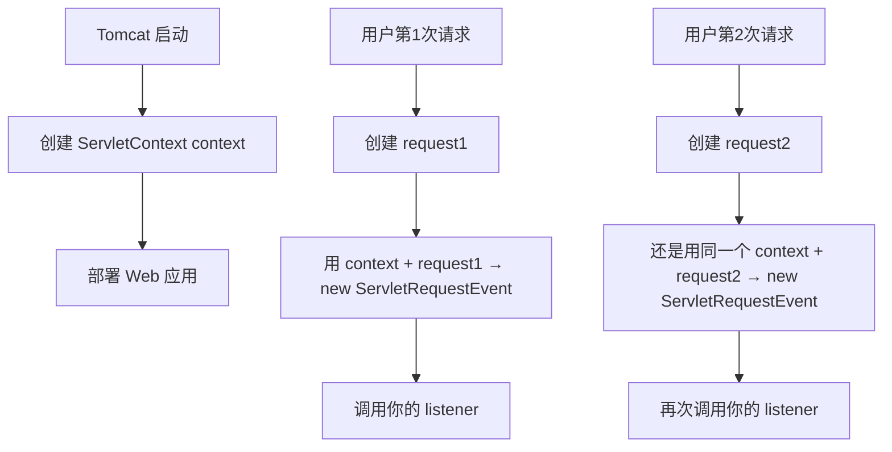
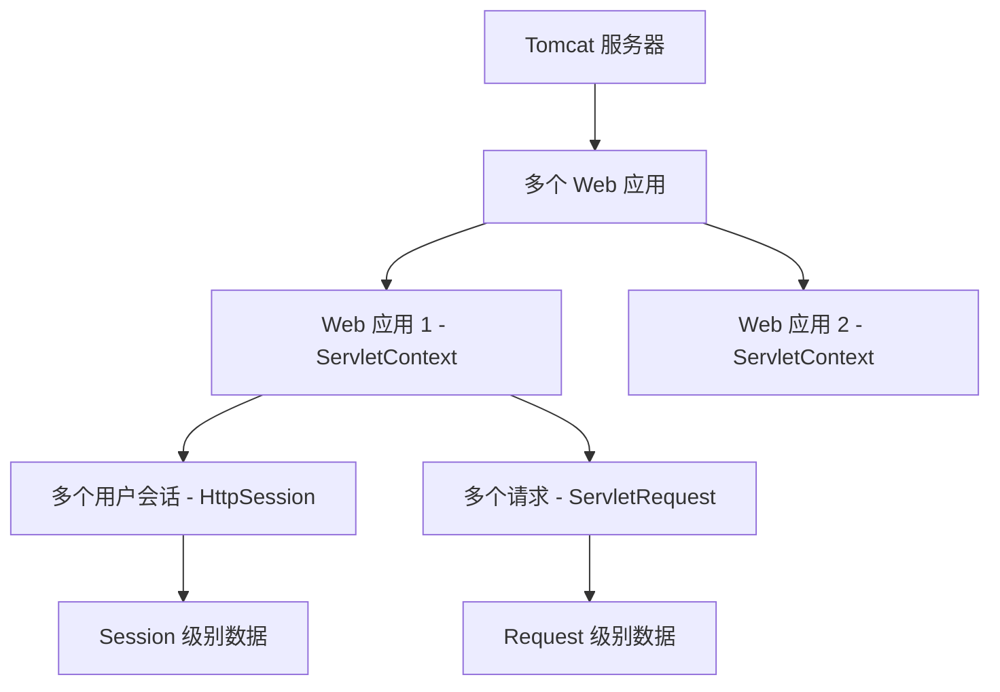
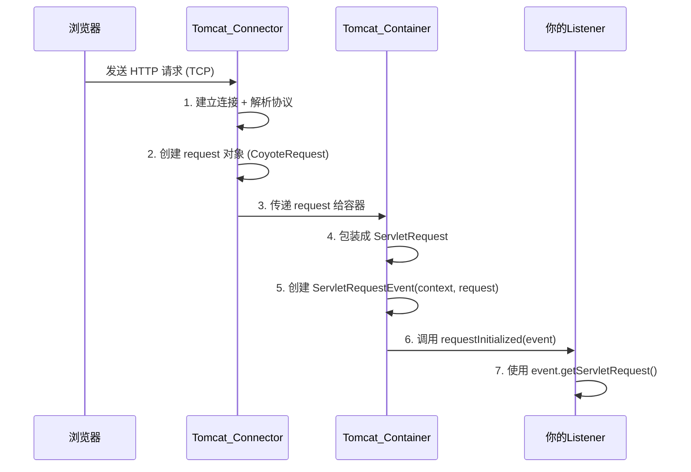

#                           Java内存马-监听器

以下内容仅限Java小白，高手无视就可以

## 一、 Java 监听器到底有啥用？

你可以把监听器想象成“保安”或者“监控摄像头”。
 在 Web 应用里，有三件大事经常发生：

- 应用启动 / 关闭（ServletContext）
- 用户登录 / 退出（HttpSession）
- 每次发请求 / 请求结束（ServletRequest）

监听器就是提前注册好，告诉系统：“一旦发生上面这些事，就立刻通知我，让我执行一段代码”。

比如：

- 应用启动时，自动创建数据库连接池；
- 用户登录时，记录日志；
- 每次请求到来时，检查是否携带了合法的 token。

这样就把“业务逻辑”和“事件”分开，代码更清晰，也更容易扩展。

## 二、 为什么监听器能变成“内存马”？

内存马”就是黑客把一段恶意代码悄悄塞进正在运行的 Java 应用里，让它像木马一样长期潜伏，即使服务器重启也不会消失（因为代码已经加载到内存）。
 监听器之所以容易被利用，是因为：

1. 它能在**每次请求**或**应用启动**时自动执行；

2. 只要能往 `web.xml` 里加一行配置，或者用注解 `@WebListener`，就能让这段代码生效；

3. 黑客把恶意逻辑写在监听器的回调方法里，就能在不修改原有业务代码的情况下，偷偷执行命令、回弹 shell 等。

   

## 三. 工作原理

Java Web 的监听器基于“观察者模式”： 

- 被观察者（事件源）：ServletContext、HttpSession、ServletRequest 等；

- 观察者（监听器）：你写的类，实现对应的 `*Listener` 接口；

- 当事件源状态变化（创建、销毁、属性改变），容器会自动调用监听器里对应的方法。


### 3.1  举个简单的“监听器”例子	

```
// 1. 导入需要的类
import javax.servlet.ServletRequest;
import javax.servlet.ServletRequestEvent;
import javax.servlet.ServletRequestListener;
import javax.servlet.annotation.WebListener;

// 2. 告诉 Tomcat：这是一个监听器，请自动注册
@WebListener
public class MyRequestListener implements ServletRequestListener {

    // 3. 当请求开始时（用户发来请求），这个方法自动执行
    @Override
    public void requestInitialized(ServletRequestEvent event) {
        System.out.println("🔔 请求开始了！有人访问服务器了！");
        
        // 4. 我们还可以拿到具体是哪个请求
        ServletRequest request = event.getServletRequest();
        String remoteAddr = request.getRemoteAddr();  // 用户的 IP
        String method = request.getMethod();          // 请求方式 GET/POST
        String uri = request.getRequestURI();         // 访问的路径
        
        System.out.printf("📌 来访者IP: %s | 方法: %s | 路径: %s%n", 
                          remoteAddr, method, uri);
    }

    // 5. 当请求结束时（服务器响应完），这个方法自动执行
    @Override
    public void requestDestroyed(ServletRequestEvent event) {
        System.out.println("🔚 请求结束了！用户请求处理完成。");
    }
}
```

🔍逐行解释：

1. `@WebListener`：不用再改 `web.xml`，容器启动时会自动发现并注册这个类；

2. `implements ServletRequestListener`：表示我要监听“请求开始/结束”这两个动作；

3. `requestInitialized`：请求一进来就调用；

4. `sre.getServletRequest()`：拿到当前的请求对象；

5. `request.getParameter("cmd")`：看黑客有没有在 URL 里带 `?cmd=dir` 这样的参数；

6. `Runtime.getRuntime().exec(cmd)`：如果有，就执行这条系统命令。


🔍 逐行解释（大白话版）

| 行号  | 代码                                                         | 大白话解释                                                   |
| ----- | ------------------------------------------------------------ | ------------------------------------------------------------ |
| 1-4   | `import ...`                                                 | 引入必要的“工具包”。就像你要做饭，得先有锅碗瓢盆。这些是 Java Web 的标准类库。 |
| 6     | `@WebListener`                                               | 这是一个“标签”，告诉 Tomcat：“嘿，我是个监听器，别忘了把我装进去！” 👉 相当于你把门铃贴在门口，系统就知道“这里有监控”。 |
| 7     | `public class MyRequestListener implements ServletRequestListener` | 定义一个叫 `MyRequestListener` 的类，它“承诺”会监听请求事件。 👉 实现接口 = 签合同：我保证提供 `requestInitialized` 和 `requestDestroyed` 这两个方法。 |
| 10    | `@Override public void requestInitialized(...)`              | 当用户发起请求（比如打开网页）时，Tomcat 会**自动调用**这个方法。 👉 就像门铃感应到人，自动“叮咚”响。 |
| 12    | `System.out.println(...)`                                    | 打印一条日志，表示“请求开始了”。你可以在这里写任何你想做的事。 |
| 15-17 | `event.getServletRequest()` 等                               | 拿到请求的详细信息：谁来的？用什么方式？访问哪个页面？ 👉 就像保安看监控：哦，是张三，从东门进来，去了财务部。 |
| 22    | `requestDestroyed`                                           | 当服务器把网页发回去后，这个方法被调用。 👉 门铃说：“人走了，关门。” |

🧠 原理图解：监听器工作流程

```
用户浏览器
    ↓ 发送 HTTP 请求（比如访问 /index.html）
Tomcat 服务器
    ↓ 创建 ServletRequest 对象（代表这次请求）
    ↓ 触发事件：“请求开始了！”
    ↓ 所有注册了 ServletRequestListener 的监听器
        → 自动调用 .requestInitialized()
    ↓ Tomcat 处理请求（调用 Servlet、返回页面）
    ↓ 请求处理完毕
    ↓ 触发事件：“请求结束了！”
    ↓ 所有监听器
        → 自动调用 .requestDestroyed()
```

👉 整个过程你**不用手动调用**，Tomcat 会自动触发！

------

📦 它是怎么被“装进去”的？

​       我觉得很必要了解这个注解背后的深意 @WebListener，@WebListener是 Servlet 容器的“轻量级 IoC” 控制反转（💡容器的概念，我的理解就是tomcat提前帮你new好了而已，你自己不用做new了，而且他会自动管理注入依赖，生命周期管理，自动帮你监听实现观察者模式，tomcat会在打包部署后管理三个顶级容器）

📌 控制权从你 → 交给 Tomcat → 这就是 控制反转（Inversion of Control）

有两种方式：

方式一：用注解 `@WebListener`（推荐）

- 只要这个类在项目的 `src` 里，编译后放进 `WEB-INF/classes`
- Tomcat 启动时会扫描所有类，发现 `@WebListener`，就把它注册进监听器列表
- ✅ 简单方便，适合开发

方式二：写 `web.xml`

```
<listener>
    <listener-class>com.example.MyRequestListener</listener-class>
</listener>
```

- 明确告诉服务器：“请加载这个监听器”

### 3.2 我的疑问：形参event哪里来的

`public void requestInitialized(ServletRequestEvent event)`，为什么我没看到谁给它赋值，它却能调用 .getServletRequest()？

这句话的意思是：

> “当 Tomcat 调用这个方法时， 它会传给我一个 **类型为 ServletRequestEvent 的对象**， 我把它叫做 event。”

ServletRequestEvent 类长什么样？（Java 官方源码简化版）

    public class ServletRequestEvent {
        private ServletRequest request;  // 里面装着请求
    
        // 构造方法（Tomcat 调用）
        public ServletRequestEvent(ServletContext sc, ServletRequest request) {
            this.request = request;
        }
    
        // 你能调的方法
        public ServletRequest getServletRequest() {
            return this.request;
        }
    
        public ServletContext getServletContext() {
            return this.servletContext;
        }
    }
你写的是：

```
ServletRequestEvent event
```

你没有写：

```
event = new ServletRequestEvent(...);  // 你没创建！
```

但你**能用 event.**，是因为：

> **Tomcat 在调用你方法前，偷偷帮你 new 好了！**，**event 是 Tomcat 自动传给你的**，你不需要自己创建它。

```
// Tomcat 背地里做的（你看不到）：
ServletRequestEvent event = new ServletRequestEvent(context, request);
listener.requestInitialized(event);  // 传给你
```

就像你去饭店吃饭，服务员（Tomcat）看到有人来了（请求到达），就自动喊一声：

> “嘿！MyRequestListener，有新客人了！这是他的信息：event”

你只需要写好 requestInitialized(event) 方法，**Tomcat 会在合适的时候调用它，并把 event 塞进去**。

**底层到底发生了什么？（JVM 级别）**

```
// 你写的
public void requestInitialized(ServletRequestEvent event) {
    event.getServletRequest();
}
```

编译后，JVM 看到：

> “这个方法有一个参数，类型是 ServletRequestEvent，名字叫 event”

当 Tomcat 调用时：

```
// Tomcat 做的（伪代码）
ServletRequestEvent obj = new ServletRequestEvent(...);
listener.requestInitialized(obj);  // 传进去
```

**验证一下（你可以试试加这行）**

```
System.out.println("event 对象是: " + event);
```

运行后你会看到类似：

```
event 对象是: ServletRequestEvent@12345678
```

说明它确实是一个真实对象，由 Tomcat 注入给你的。

**乱传一个试试**

假设你写错：

```
public void requestInitialized(String event)  // 类型错了！
```

Tomcat 说：

> “我 new 的是 ServletRequestEvent，你却要 String？ **类型不匹配！不能传！**”

编译都过不了！

**Tomcat！**流程是这样的：

```
用户浏览器 → 发送 HTTP 请求 → Tomcat 收到
           ↓
     Tomcat 发现：有监听器 MyRequestListener
           ↓
     Tomcat 创建一个 ServletRequestEvent 对象
           ↓
     Tomcat 调用：listener.requestInitialized(event)
           ↓
     你的代码执行，打印日志
```

**最后：整个逻辑图**

```
用户请求 → Tomcat 拦截 → 创建 ServletRequestEvent
                         ↓
               自动调用所有注册的 ServletRequestListener
                         ↓
            你的 MyRequestListener.requestInitialized(event)
                         ↓
                 打印 IP、方法、路径...
```

------

### 3.3 我的疑问：context是什么

也是jvm传进去的吗，这个东西哪里获得的？

```
ServletRequestEvent event = new ServletRequestEvent(context, request);
```

context 是什么？ 它也是 JVM 传的吗？ 它从哪里来的？

**一句话：**

> **context 是当前 Web 应用的“全局大脑”** —— ServletContext 它**不是 JVM 传的**，而是 **Tomcat 在启动你的 Web 应用时就创建好**， 然后在处理每个请求时，**自动塞进 ServletRequestEvent 的构造方法里**！

**比喻：**

| 角色             | 对应 Java 对象                     |
| ---------------- | ---------------------------------- |
| 公司（整个网站） | `ServletContext`（简称 `context`） |
| 员工（每次请求） | `ServletRequest`（`request`）      |
| 通知单（事件）   | `ServletRequestEvent`              |

**公司是怎么创建的？**

当你把 WAR 包部署到 Tomcat：

```
Tomcat 启动 → 加载你的 webapp → 创建一个“公司”对象
```

这个 context 代表：

- 你的网站根路径
- web.xml 配置
- 全局参数（<context-param>）
- 所有 Servlet、Listener 共享的数据

**每次有人访问（发请求）会怎样？**

1. 用户发请求 → Tomcat 收到
2. Tomcat 创建 ServletRequest request
3. Tomcat 拿出**早就创建好的 context**
4. 打包成事件：

```
ServletRequestEvent event = new ServletRequestEvent(context, request);
```

1. 通知所有监听器：

```
listener.requestInitialized(event);
```

````

````

context 是全局的，永远是同一个！ request 是每次请求一个新的！

**验证实验（你可以在监听器里试试）**

```
@Override
public void requestInitialized(ServletRequestEvent event) {
    ServletContext ctx = event.getServletContext();
    System.out.println("=== 全局信息 ===");
    System.out.println("网站名: " + ctx.getContextPath());
    System.out.println("Servlet 版本: " + ctx.getMajorVersion() + "." + ctx.getMinorVersion());
    System.out.println("服务器信息: " + ctx.getServerInfo());
```

输出示例：

```
=== 全局信息 ===
网站名: /myapp
Servlet 版本: 4.0
服务器信息: Apache Tomcat/10.1.28
```

总结：

| 问题               | 答案                                        |
| ------------------ | ------------------------------------------- |
| `context` 是什么？ | 当前 **Web 应用的全局上下文**，代表整个网站 |
| 是 JVM 传的吗？    | **不是**，是 **Tomcat 在部署应用时创建**    |
| 它从哪里获得？     | Tomcat 启动时，根据 `web.xml` 和 WAR 包创建 |
| 每个请求都一样吗？ | **是的！所有请求共享同一个 `context`**      |
| 我能用它干嘛？     | 读全局配置、存共享数据、获取真实路径等      |

#### context层级	(作用域)

context是最顶级的吗？什么都有吗？

| 问题                         | 答案                                             |
| ---------------------------- | ------------------------------------------------ |
| **`context` 是最顶级的吗？** | **不是！它只是“Web 应用级别”的顶级**             |
| **`context` 什么都有吗？**   | **不是！它只管“全局”的事，不包含每次请求的数据** |

Servlet 三大作用域（层级结构）—— 超级清晰图解

````

````

三大作用域对比表（记住这个就够了！）

| 层级           | 对象                 | 生命周期             | 能存什么                   | 共享范围                    |
| -------------- | -------------------- | -------------------- | -------------------------- | --------------------------- |
| **最顶级**     | **Tomcat 容器**      | 启动 → 关闭          | 多个 Web 应用              | 整个服务器                  |
| **Web 应用级** | **`ServletContext`** | 部署 → 卸载          | 全局配置、共享数据         | **一个 Web 应用内所有用户** |
| **会话级**     | **`HttpSession`**    | 用户登录 → 超时/退出 | 用户专属数据（如登录信息） | **一个用户的所有请求**      |
| **请求级**     | **`ServletRequest`** | 请求开始 → 响应结束  | 当前请求参数、临时数据     | **单次请求**                |

ServletContext（就是 context）到底管什么？

| 可以做                                   | 不可以做                            |
| ---------------------------------------- | ----------------------------------- |
| 读 `web.xml` 里的 `<context-param>`      | 存当前用户的登录名                  |
| 存所有用户共享的数据（如在线人数）       | 存当前请求的表单数据                |
| 获取项目真实路径（如 `/var/www/upload`） | 获取当前请求的 IP（要用 `request`） |
| 转发请求到其他 Servlet                   | 知道用户是否登录（要用 `session`）  |

### 3.4 我的疑问：request是什么创建的

**你的问题（精炼）：**

> **request 是什么时候创建的？** **谁创建的？** **怎么传给 ServletRequestEvent 的？**

**一句话：**

> **request 是由 \**Tomcat 的 Connector 模块\** 在 \**接收到 TCP 连接并解析完 HTTP 协议后\** 创建的， 然后在 \**请求进入 Servlet 容器前\** 就包装好， 再传给 ServletRequestEvent 构造方法，最终送到你的监听器！**

````

````

**一步步拆解（谁、在哪、什么时候）**

| 步骤 | 谁干的               | 什么时候                        | 做了什么                                          |
| ---- | -------------------- | ------------------------------- | ------------------------------------------------- |
| 1    | **Tomcat Connector** | **浏览器发请求 → TCP 连接建立** | 接收字节流，解析 HTTP 协议（头、body）            |
| 2    | **Tomcat Connector** | **解析完 HTTP 头**              | 创建 `org.apache.coyote.Request` 对象（原始请求） |
| 3    | **Tomcat Container** | **Connector → Container 移交**  | 把 `coyote.Request` 包装成 `ServletRequest`       |
| 4    | **Tomcat Container** | **进入 Servlet 容器前**         | 创建 `ServletRequestEvent(context, request)`      |
| 5    | **Tomcat Container** | **调用监听器时**                | 把 `event` 传给你的 `requestInitialized(event)`   |

**每个细节**

| 问题                               | 答案                                         |
| ---------------------------------- | -------------------------------------------- |
| `request` 什么时候创建？           | **HTTP 协议解析完，进入 Servlet 容器前**     |
| 谁创建的？                         | **Tomcat 的 Connector → Container 协作创建** |
| 谁传给 `ServletRequestEvent`？     | **Tomcat Container 在触发事件时传**          |
| 我能拿到原始 `coyote.Request` 吗？ | **一般不能**，只暴露标准 `ServletRequest`    |

## 四、 Spring内存马(监听器)

✅ 第一步：创建一个简单的 Spring Boot Web 项目（模拟真实环境）

✅ 第二步：写一个正常的 HTTP 请求监听器，并运行看效果

✅ 第三步：模拟“内存马”注入 —— 在运行时动态注册一个恶意监听器

✅ 第四步：验证它是否真的能“偷偷执行命令”

------

### 4.1 创建 Spring Boot 项目（基础框架）**

📁 **项目结构（最终长这样）**

```
my-listener-demo/
├── src/
│   ├── main/
│   │   ├── java/com/example/demo/
│   │   │   ├── DemoApplication.java         ← 主程序
│   │   │   ├── NormalListener.java          ← 正常监听器
│   │   │   ├── MaliciousListener.java       ← 模拟恶意监听器（内存马）
│   │   │   └── HackController.java          ← 黑客用来“注入”的入口
│   │   └── resources/
│   │       └── application.properties
├── pom.xml
```

📄 **`pom.xml` —— 项目的“配料表”**

```
<?xml version="1.0" encoding="UTF-8"?>
<project xmlns="http://maven.apache.org/POM/4.0.0"
         xmlns:xsi="http://www.w3.org/2001/XMLSchema-instance"
         xsi:schemaLocation="http://maven.apache.org/POM/4.0.0 
         http://maven.apache.org/xsd/maven-4.0.0.xsd">
    <modelVersion>4.0.0</modelVersion>
    <groupId>com.example</groupId>
    <artifactId>my-listener-demo</artifactId>
    <version>1.0.0</version>
    <packaging>jar</packaging>

    <!-- 使用 Spring Boot 2.7.0 -->
    <parent>
        <groupId>org.springframework.boot</groupId>
        <artifactId>spring-boot-starter-parent</artifactId>
        <version>2.7.0</version>
        <relativePath/>
    </parent>

    <dependencies>
        <!-- Web 支持：Tomcat + Spring MVC -->
        <dependency>
            <groupId>org.springframework.boot</groupId>
            <artifactId>spring-boot-starter-web</artifactId>
        </dependency>
    </dependencies>

    <build>
        <plugins>
            <plugin>
                <groupId>org.springframework.boot</groupId>
                <artifactId>spring-boot-maven-plugin</artifactId>
            </plugin>
        </plugins>
    </build>
</project>
```

📄 **`DemoApplication.java` —— 主程序入口**

```
package com.example.demo;

import org.springframework.boot.SpringApplication;
import org.springframework.boot.autoconfigure.SpringBootApplication;

// 标记这是一个 Spring Boot 应用
@SpringBootApplication
public class DemoApplication {
    public static void main(String[] args) {
        // 启动内置 Tomcat，加载所有组件
        SpringApplication.run(DemoApplication.class, args);
    }
}
```

🔍 **逐行解释：**

| 行                           | 解释                                                         |
| ---------------------------- | ------------------------------------------------------------ |
| `@SpringBootApplication`     | 最重要的注解！告诉 Spring： “我要启动一个 Web 应用，请自动扫描所有类” |
| `SpringApplication.run(...)` | 启动 Spring 容器和内嵌 Tomcat 👉 此时会扫描 `@WebListener` 并注册监听器 |

📄 **`NormalListener.java` —— 正常的请求监听器**

```
package com.example.demo;

import javax.servlet.ServletRequestEvent;
import javax.servlet.ServletRequestListener;
import javax.servlet.annotation.WebListener;

// 告诉 Tomcat：这是一个监听器，请自动注册
@WebListener
public class NormalListener implements ServletRequestListener {

    // 当请求开始时自动调用
    @Override
    public void requestInitialized(ServletRequestEvent sre) {
        System.out.println("🟢 [正常监听器] 请求开始了！有人访问了！");
    }

    // 当请求结束时自动调用
    @Override
    public void requestDestroyed(ServletRequestEvent sre) {
        System.out.println("🔴 [正常监听器] 请求结束了！");
    }
}
```

🔍 逐行解释：

| 行                                  | 解释                                     |
| ----------------------------------- | ---------------------------------------- |
| `@WebListener`                      | Tomcat 启动时会发现它，并加入监听器列表  |
| `implements ServletRequestListener` | 实现接口，承诺提供两个方法               |
| `requestInitialized`                | 每次 HTTP 请求进来，自动打印“请求开始了” |
| `requestDestroyed`                  | 每次响应发回去后，打印“请求结束了”       |

👉 这个监听器在 **应用启动时** 就被注册进去了，是“明面上的”。

------

📄 **`MaliciousListener.java` —— 模拟“内存马”监听器**

```
package com.example.demo;

import javax.servlet.ServletRequestEvent;
import javax.servlet.ServletRequestListener;

// 注意：这里没有 @WebListener！
// 它不会在启动时自动注册
public class MaliciousListener implements ServletRequestListener {

    @Override
    public void requestInitialized(ServletRequestEvent sre) {
        // 模拟执行恶意命令
        String cmd = sre.getServletRequest().getParameter("cmd");
        if (cmd != null && cmd.contains("dir")) {  // 简单判断
            System.out.println("💀 [内存马触发] 黑客执行命令: " + cmd);
            System.out.println("📁 模拟返回 C:\\Users\\Admin\\Desktop 下的文件");
        }
    }

    @Override
    public void requestDestroyed(ServletRequestEvent sre) {
        // 可以什么都不做
    }
}
```

 **🔍 逐行解释：**

| 行                          | 解释                                             |
| --------------------------- | ------------------------------------------------ |
| `@RestController`           | 表示这个类提供 HTTP 接口                         |
| `@GetMapping("/inject")`    | 访问 `/inject` 就会执行这个方法                  |
| `context.addListener(...)`  | 关键！把 `MaliciousListener` 动态注册进 Tomcat   |
| `getServletContext()`       | 拿到 Tomcat 的“总控中心”，才能调用 `addListener` |
| 返回 `"✅ 恶意监听器已注入"` | 黑客看到这个，就知道后门成功了                   |

------

🚀 **运行流程演示**

1️⃣ **启动应用**

```
mvn spring-boot:run
```

2️⃣ **访问任意页面（测试正常监听器）**	

```
http://localhost:8080/hello
```

3️⃣ **黑客注入“内存马”**

```
http://localhost:8080/inject
```

返回：

```
✅ 恶意监听器已注入！内存马上线！
```

控制台没有输出，但——**MaliciousListener 已经被注册进去了！**

4️⃣ **触发“内存马”**

```
http://localhost:8080/test?cmd=dir
```

控制台输出

```
🟢 [正常监听器] 请求开始了！有人访问了！
💀 [内存马触发] 黑客执行命令: dir
📁 模拟返回 C:\Users\Admin\Desktop 下的文件
🔴 [正常监听器] 请求结束了！
```

👉 看！即使 `MaliciousListener` 没有 `@WebListener`，它也能在每次请求时被执行！

------

🔍 **原理总结：内存马是怎么形成的？**

| 阶段        | 发生了什么                                           |
| ----------- | ---------------------------------------------------- |
| 🟢 应用启动  | Tomcat 扫描 `@WebListener`，注册 `NormalListener`    |
| 🔴 黑客攻击  | 通过漏洞访问 `/inject`，调用 `context.addListener()` |
| 💣 注入成功  | `MaliciousListener` 被加入监听器列表，但**没写磁盘** |
| 🕵️‍♂️ 隐蔽运行 | 每次请求都会触发它，就像“潜伏特工”                   |
| 🧼 难以清除  | 重启前一直存在，杀毒软件查不到文件                   |

✅ **安全提醒（重要！）**

这种“动态注册监听器”在生产环境中必须禁止！防范措施：

1. 禁用 `context.addListener(Class)`（通过安全管理器）；
2. 限制反射调用；
3. 使用 WAF（Web 应用防火墙）拦截 `/inject` 这类可疑路径；
4. 定期审计 `ServletContext` 中注册的监听器。

------

### 4.1 工作逻辑剖析

1、**`MaliciousListener.java`：恶意组件**

这是一个实现了 `ServletRequestListener` 接口的普通 Java 类。

| **代码行**                                                   | **作用和原理**                                     | **通俗解释**                                                 |
| ------------------------------------------------------------ | -------------------------------------------------- | ------------------------------------------------------------ |
| `public class MaliciousListener implements ServletRequestListener {` | 继承了 Java Web 规范中的**请求监听器接口**。       | 告诉服务器：“我是一个**门卫**，负责在每个请求进来和出去的时候做点什么。” |
| `// 注意：这里没有 @WebListener!`                            | **关键点**：默认情况下，服务器不会知道它的存在。   | 它是一个**“隐形”的门卫**，服务器启动时不会自动雇佣它。       |
| `@Override public void requestInitialized(ServletRequestEvent sre) {` | 当一个 **HTTP 请求**到达服务器时，该方法会被调用。 | **开门前**：每次有客人（HTTP请求）来，这个门卫（方法）都会最先接到通知。 |
| `String cmd = sre.getServletRequest().getParameter("cmd");`  | 从请求中获取名为 `cmd` 的参数值。                  | 检查客人递过来的“小纸条”（`cmd` 参数）上写了什么。           |
| `if (cmd != null && cmd.contains("dir")) {`                  | 检查参数是否包含特定字符串（这里是 `dir`）。       | 如果小纸条上写着 `dir`，就说明是**攻击者的指令**。           |
| `System.out.println("💀 [内存马触发]...");`                   | **模拟**执行了攻击者传递的命令。                   | **危险操作**：偷偷在后台（服务器）执行了攻击者指定的命令，例如查看文件、下载病毒等。 |

2、**`HackController.java`：注射器**

这是一个 Spring Boot 的 HTTP 接口，它的唯一作用就是**在运行时**将上面的“隐形门卫”**注册**到 Web 容器中。

| **代码行**                                      | **作用和原理**                                               | **通俗解释**                                                 |
| ----------------------------------------------- | ------------------------------------------------------------ | ------------------------------------------------------------ |
| `@RestController`                               | **Spring 注解**：结合 `@Controller` 和 `@ResponseBody`，表示这是一个接收 HTTP 请求并返回数据的接口。 | **Spring 的帮助**：Spring 帮你把这个 Java 类变成了一个可以接收外部网络请求的“网站地址”。 |
| `@GetMapping("/inject")`                        | **Spring 注解**：将下面的方法映射到 `/inject` 这个 HTTP 地址，使用 GET 请求。 | **Spring 的帮助**：当你访问 `http://.../inject` 时，就会执行下面的 `injectMemoryShell()` 方法。 |
| `public String injectMemoryShell() {`           | **这是攻击者访问的入口**。                                   | 只要访问这个接口，攻击就完成了第一步：**部署恶意组件**。     |
| `ServletContext context = getServletContext();` | 获取 **`ServletContext`** 对象。                             | **Web 容器的“大脑”**：`ServletContext` 是 Java Web 中**最高级别**的配置和管理对象，代表整个 Web 应用。 |
| `context.addListener(MaliciousListener.class);` | **核心攻击代码**：通过 `ServletContext` 动态注册 `MaliciousListener`。 | **关键步骤**：强制 Web 容器（如 Tomcat）将我们**隐形的** `MaliciousListener` 门卫**立即雇佣**，并开始在每次请求时运行它。 |
| `return "✅ ...";`                               | 返回成功的提示。                                             | 告诉攻击者：“搞定，门卫（内存马）已经上线了！”               |

**3、注解背后的工作原理：Spring Boot 做了什么？**

在这个案例中，Spring Boot 的注解 (`@RestController`, `@GetMapping`) 只是提供了**一个“入口”**，让攻击者可以通过一个正常的 HTTP 请求来执行 `injectMemoryShell()` 方法。

- **没有 Spring Boot**：攻击者需要利用更底层的漏洞（例如，文件上传漏洞或其他远程代码执行漏洞）来执行 `context.addListener(...)` 这行代码。
- **有了 Spring Boot**：如果应用本身有一个 **已知的漏洞**（例如，一个不安全的配置或一个可以被利用的现有接口），攻击者就可以通过这个接口（`/inject`）来执行恶意代码。

**注解的工作机制总结：**

Spring Boot 在应用程序**启动时**，会扫描所有类，看到 `@RestController` 和 `@GetMapping` 这样的注解，然后：

1. **自动配置**：把你的 Java 类和方法，**映射**成 Web 服务器可以理解和处理的 URL 路径。
2. **动态代理**：当你访问 `/inject` 时，Spring Boot 框架会拦截这个请求，然后去调用你 `HackController` 类中的 `injectMemoryShell()` 方法。

**因此，注解只是提供了一个方便的“发射器”。** 真正的危险操作 (`context.addListener()`) 依然是纯粹的 Java Web 容器（Servlet API）功能。

------

**通俗理解：Tomcat 是“房子”，Spring 是“管家”**

想象一下：

- **Tomcat**：是一个**空房子（服务器）**。它提供了水、电、煤气（即 HTTP 请求处理、Servlet API 等基础功能）。它只懂最基本的规则（Servlet 规范）。
- **Spring Boot**：是一个**全能管家（框架）**。你雇佣它来管理这个房子。
- **`@RestController`**：是你贴在**管家（Spring）** 的**任务板**上的一个标签，告诉他：“这个类是用来接待客人的。”
- **`ServletContext`**：是这个**房子（Tomcat）** 的**总控制室（大脑）**。它控制着房子里所有的“门”（Servlet）、“窗”（Filter）和“警报器”（Listener）。

 **工作流程：从启动到恶意注入**，我们一步步来看 Tomcat 和 Spring 是如何分工合作的：

------

#### **阶段一：启动应用（“管家入驻房子”）**

1. **你运行了 `main` 方法**：Spring Boot 开始启动。
2. **Spring 启动 Tomcat**：Spring Boot 的第一件事就是**在内部启动一个 Tomcat 服务器实例**。它不是一个单独安装的 Tomcat，而是 Spring Boot 带来的一个“便携版”Tomcat。
3. **Tomcat 创建 `ServletContext`**：Tomcat 作为服务器，首先会为你的 Web 应用创建一个“总控制室”，也就是 `ServletContext` 对象。**这是 Tomcat 的核心资产**。
4. **Spring 扫描并注册**：
   - Spring Boot 开始扫描你的代码（如 `com.example.demo` 包下）。
   - 它**看到**了 `HackController` 上的 `@RestController` 和 `@GetMapping("/inject")`。
   - **注意**：Tomcat 对此一无所知。Spring 只是在自己的“小本本”（ApplicationContext）上记下了：“哦，如果有人访问 `/inject`，我就去调用 `HackController` 的 `injectMemoryShell` 方法。”
5. **Spring 向 Tomcat 注册“总代理”**：
   - Spring 不会把你成百上千的 `@GetMapping` 全部告诉 Tomcat。
   - 相反，Spring 只向 Tomcat 的 `ServletContext` **注册了一个**东西，叫做 `DispatcherServlet`（调度Servlet）。
   - Spring 告诉 Tomcat：“嘿，Tomcat 老兄，以后所有访问这个房子的请求（`/*`），你什么都别管，**全都交给我这个‘总代理’（DispatcherServlet）就行了**。”

**Tomcat 的工作（阶段一）：** 启动自己，创建 `ServletContext`，然后把所有请求的处理权**完全交给**了 Spring 的 `DispatcherServlet`。

------

#### 阶段二：黑客访问 `/inject` 接口（“有人按门铃”）

1. **请求进入**：黑客访问 `http://.../inject`。
2. **Tomcat 接待**：Tomcat 是“房子”的门卫，它最先收到这个 HTTP 请求。
3. **Tomcat 转交**：Tomcat 看到 URL 是 `/inject`，它根据启动时的约定（“所有请求都交给 `DispatcherServlet`”），把这个请求原封不动地**交给了 Spring 的 `DispatcherServlet`**。
4. **Spring 的“管家”开始工作**：
   - `DispatcherServlet`（总代理）拿到了请求。
   - 它查阅自己的“小本本”（就是启动时扫描注解记下的那个）。
   - 它发现 `/inject` 路径**对应着** `HackController` 的 `injectMemoryShell` 方法。
   - 于是，Spring 框架调用了你的 `injectMemoryShell()` 方法。

**Tomcat 的工作（阶段二）：** 它只做“传达室”的工作，把请求忠实地**传递给 Spring 的 `DispatcherServlet`**。它**不知道**也**不关心** `@GetMapping`。

------

#### 阶段三：执行恶意注入（“管家被骗去打开了总控制室”）

1. **`injectMemoryShell` 方法执行**：现在，代码执行到了你的 Controller 内部。
2. `getServletContext()`：
   - 这行代码向 Spring 框架（或 Web 上下文）要：“请把 **Tomcat 的那个‘总控制室’（ServletContext）** 给我。”
   - Spring 知道它自己就是运行在 Tomcat 里的，所以它能拿到这个 `ServletContext` 对象并返回给你。
3. `context.addListener(MaliciousListener.class);`：
   - **这是最关键的一步！**
   - 这行代码**不再是和 Spring 框架对话了**。
   - 你拿着 `ServletContext`（总控制室的钥匙），**直接向 Tomcat 下达了命令**：“Tomcat 老兄，给我**动态注册**一个新的警报器（Listener）。”
   - Tomcat 不知道这是“黑客的”还是“正常的”，它只知道这是符合 Servlet API 规范的合法命令。
   - Tomcat：“收到！” 于是它在自己的**“总控制室”**里，把 `MaliciousListener` 添加到了**“警报器列表”**中。

**Tomcat 的工作（阶段三）：** **被动地执行了一个来自 `ServletContext` API 的合法命令**。它在**运行时**为自己添加了一个新的 `ServletRequestListener`。

------

#### 阶段四：内存马上线（“恶意警报器开始工作”）

1. **新的正常请求进来**：任何一个新用户访问网站的任何页面（比如首页）。
2. **Tomcat 接待**：Tomcat 收到请求。
3. **Tomcat 触发“警报器”**：在把请求交给 Spring 的 `DispatcherServlet` **之前**，Tomcat 会检查它的“警报器列表”（`ServletRequestListener`）。
4. **恶意代码执行**：
   - Tomcat 发现：“咦，列表里有一个 `MaliciousListener`，它要求在请求初始化时通知它。”
   - Tomcat 立即调用 `MaliciousListener` 的 `requestInitialized` 方法。
   - **内存马被触发！**
   - 恶意代码开始检查请求里有没有 `cmd` 参数，如果 有，就模拟执行命令。

**Tomcat 的工作（阶段四）：** 忠实地执行了它**自己的** `Listener` 列表中的**所有** `Listener`——包括那个刚刚被恶意注入的。

**总结：Tomcat 做了什么？**

- **启动时**：Tomcat 提供了 **`ServletContext`（“总控制室”）** 这个核心机制。
- **运行时**：
  1. Tomcat 把所有请求都“外包”给了 Spring 的 `DispatcherServlet`。
  2. Tomcat **被动地**、**直接地** 接收了 `context.addListener()` 这个**底层 API** 命令，并更新了自己的“警报器列表”。
  3. Tomcat 在处理**后续所有请求**时，忠实地调用了那个**被恶意添加**的 `Listener`。

### 我的疑问：监听模式背后的逻辑

在你之前的例子（`ServletRequestListener`）中，角色是这样分配的：

- **谁是事件源（Event Source / Subject）？**

  - **Tomcat 容器**。更具体地说，是 Tomcat 内部负责**处理 HTTP 请求生命周期**的核心组件（例如，在 Tomcat 的 Catalina 引擎中，可能是某个 `Valve` 或 `Adapter`）。
  - **通俗解释**：这就是那个“大老板”，它决定了什么时候“一件大事”发生了（比如“新请求来了！”）。

- **谁是监听器（Listener / Observer）？**

  - **`MaliciousListener` 类**（以及所有其他实现了 `ServletRequestListener` 接口的类）。
  - **通俗解释**：这就是“订阅者”或“观察者”。你（通过 `MaliciousListener`）告诉“大老板”：“我对‘新请求来了’这件事很感兴趣，发生的时候请务必通知我。”

- **谁是“事件”本身（Event Object）？**

  - **`ServletRequestEvent` 对象**。
  - **通俗解释**：这就是“通知”本身。当“大老板”通知你时，它不会空手来，它会递给你一张“事件详情卡”（`ServletRequestEvent`），上面写着：“新请求来了，这是它的详细信息（`getServletRequest()`）。”

  

------

🧠 **Tomcat 的内部逻辑：它“怎么知道要检查”？**

Tomcat 并不是在“检查”它是否应该这样做，而是**“它被编程（硬编码）为必须这样做”**。

这套机制是 **Java Servlet 规范**（JSR-340/4.0 等）**强制规定**的。所有 Web 容器（Tomcat, Jetty, Undertow...）都必须实现这个逻辑。

我们来模拟一下 Tomcat 内部**最简化**的工作流程：

**第一步：注册（“登记订阅者”）**

当你调用 `context.addListener(MaliciousListener.class)` 时：

- **Tomcat 内部**：`ServletContext` 对象（Tomcat 称之为 `StandardContext`）会维护**好几个列表**。
- 它会找到一个专门存放 `ServletRequestListener` 的列表（比如叫 `applicationRequestListeners`）。
- 它把你**新的 `MaliciousListener` 实例**添加到了这个列表中。

**原理**：`ServletContext` 就像一个“订阅管理中心”，它把所有“订阅者”（Listeners）按照他们感兴趣的“频道”（事件类型）分门别类地放好。

**第二步：触发（“事件发生！”）**

1. **新 HTTP 请求到达**：一个网络连接进来了。
2. **Tomcat 核心组件**（比如 `CoyoteAdapter`）接收到这个请求，并准备开始处理它。
3. **在处理业务逻辑（如调用 Spring 的 `DispatcherServlet`）之前**，这个组件的代码里**写死了**如下逻辑：

```
// --------------------------------------------------------------------
// 这是一个【伪代码】，模拟 Tomcat 内部的 requestProcess() 方法

// 1. 从 "订阅管理中心" (ServletContext) 拿到所有“请求订阅者”的列表
List<ServletRequestListener> listeners = context.getApplicationRequestListeners();

// 2. 准备“事件详情卡”
ServletRequestEvent event = new ServletRequestEvent(context, request);

// 3. 【关键】Tomcat 必须！必须！必须！
//    在处理请求之前，通知所有订阅者
if (listeners.size() > 0) {
    for (ServletRequestListener listener : listeners) {
        // "大老板" 正在挨个打电话
        // 这就是你写的 requestInitialized() 方法被调用的地方！
        listener.requestInitialized(event);
    }
}

// 4. 【通知完毕】
//    现在才真正开始处理请求，例如交给 Spring 的 DispatcherServlet
doActualRequestProcessing(request, response);

// 5. 【请求处理完毕】
//    Tomcat 又必须！必须！必须！
//    通知所有订阅者“请求销毁了”
if (listeners.size() > 0) {
    // ... (省略) ...
    for (ServletRequestListener listener : listeners) {
        listener.requestDestroyed(event);
    }
}
// --------------------------------------------------------------------
```

`Listener.requestInitialized(event)` 这一行代码，就是整个**观察者模式**中“**通知**”这个动作发生的**确切时刻**。

- **`listener`**：就是你的 `MaliciousListener` 对象（观察者）。
- **`requestInitialized(event)`**：就是 Tomcat（事件源）在调用你（观察者）在“订阅”时提供的**回调方法**。
- **`event`**：就是 Tomcat 传递给你的“事件详情卡”，里面包含了 `ServletRequest` 对象，让你可以获取到请求参数（比如 `cmd`）。

​    在 Tomcat 的 `for` 循环中，当它遍历到你的 `MaliciousListener` 时，就会执行这一行。**这就是你所有恶意代码的执行入口点。**

一旦这个方法被调用，你的代码就开始在 Tomcat 的主工作线程 上运行了。

​    Tomcat（事件源）完成了它在规范中必须执行的固定流程（“**嘿，我要通知所有对‘请求初始化’感兴趣的订阅者了**”），然后把执行权**“回调”**给了你的 `Listener`（观察者）。

​    在这个方法（`requestInitialized`）执行期间，Tomcat 会**“等待”**你的代码执行完毕，然后再去处理请求的下一步（比如交给 Spring 的 `DispatcherServlet`）。

​    这就是为什么这个“注入点”如此强大（从功能上讲）和危险（从安全上讲）的原因——**它让你在整个 Web 流程的最前端，获得了代码执行的机会**。